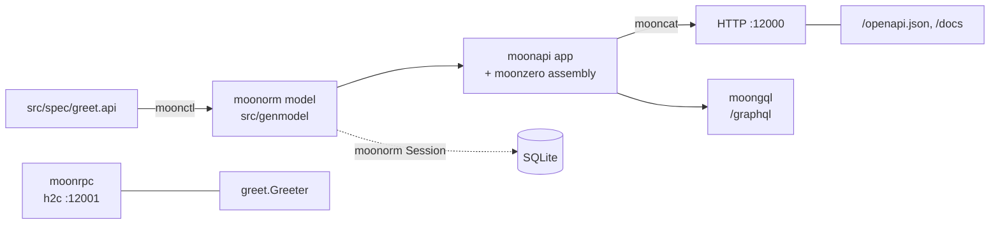

<div align="center">

# MoonBit Stack Backend Hello World

**a example greet project with a single repo.**

[](https://github.com/moonbitstack/moonhelo/actions/workflows/ci.yml)
[](./LICENSE)

</div>

One greeting service, written once, served four ways: a REST route, an OpenAPI
document, a GraphQL field and a gRPC method. It exists so that the pieces of the
stack can be run against each other in one module — a version skew between two
libraries that each pass their own tests shows up here as a build that does not
finish.

It is an application, not a library: nothing here is published for other code to
import, and the module is pinned to the native backend because it listens on a
socket and links SQLite.

<!-- nocheck -->


## What each library does here

| Stage | Library | What it does in this repo |
|:--|:--|:--|
| describe | — | `src/spec/greet.api`: a service with `/ping`, `POST /users`, `GET /users/{id}`, and a `type User` |
| generate | [moonctl](https://github.com/moonbitstack/moonctl) | reads the spec and writes the `User` model, its columns, its row decoder and its migration into `src/genmodel` |
| route | [moonapi](https://github.com/moonbitstack/moonapi) | the typed routes, the OpenAPI document, the request-id middleware, and the readers at `/docs` and `/redoc` |
| assemble | [moonzero](https://github.com/moonbitstack/moonzero) | wraps the routed application in a service with go-zero-style request logging |
| persist | [moonorm](https://github.com/moonbitstack/moonorm) | the session that writes and reads users through the generated model |
| driver | [moonsqlite](https://github.com/moonbitstack/moonsqlite) | a real SQLite file behind that session |
| serve | [mooncat](https://github.com/moonbitstack/mooncat) | runs the assembled application over native HTTP |
| transport | [moonasgi](https://github.com/moonbitstack/moonasgi) | the scope/receive/send contract every layer above shares |
| describe again | [moongql](https://github.com/moonbitstack/moongql) | `Query.greeting`, mounted on the same application and answered by the same server |
| call | [moonrpc](https://github.com/moonbitstack/moonrpc) | serves `greet.Greeter` over HTTP/2 cleartext with Server Reflection, and the client the test drives it with |
| ask a model | [moonmuse](https://github.com/moonbitstack/moonmuse) | a prompt rendered from a template and answered by a scripted provider, in `src/examples/00-nine-in-one` |
| stop and resume | [moonstate](https://github.com/moonbitstack/moonstate) | a run that stops between two nodes and continues from its checkpoint, in `src/examples/01-lifecycle` |
| call from outside | [moonfetch](https://github.com/moonbitstack/moonfetch) | the REST routes and the GraphQL field called over a real socket, in `src/examples/06-clients` |
| offer to a model | [moonmcp](https://github.com/moonbitstack/moonmcp) | the greeting as an MCP tool, served under `/mcp` by the same listener and called by moonmcp's client, in `src/examples/06-clients` |

The routes are written by hand and the model is generated, which is the ordinary
workflow around a code generator: the spec produces the types and the storage
layer, and the handlers that carry the business logic are filled in beside them.
`moonctl` is run in CI, and the model it writes is compared with the copy in the
repository, so the generated half cannot drift.

## Run it

```console
$ moon run src/gen --target native           # regenerate src/genmodel from src/spec/greet.api
$ moon test --target native                   # the end-to-end suite: a real HTTP client, a real socket
$ moon run src/cmd/greet-server --target native &
$ curl -s localhost:12000/ping                 # -> pong
$ curl -s -XPOST localhost:12000/users -d '{"name":"Ada"}'
{"id":1,"name":"Ada"}
$ curl -s localhost:12000/users/1              # -> {"id":1,"name":"Ada"}
$ curl -s localhost:12000/openapi.json         # -> the document its routes describe
$ curl -s -XPOST localhost:12000/graphql \
    -H 'content-type: application/json' \
    -d '{"query":"{ greeting(name: \"Ada\") }"}'
{"data":{"greeting":"Hello, Ada"}}
```

The same binary binds `greet.Greeter` on 12001 over HTTP/2 cleartext, so one
process serves both ports. The test drives that leg the way `grpcurl` does — reflection first, then the call — over a real socket:

```moonbit
let app = @moonapi.App::new()
app.get("/ping", _ctx => @moonapi.text(200, "pong"))
let reply = app.handle({
  http_method: "GET",
  path: "/ping",
  query_string: b"",
  headers: [],
  body: b"",
})
assert_eq(reply.status, 200)
assert_eq(@utf8.decode_lossy(reply.body), "pong")
```

That block runs in-process through `App::handle`, the same path the socket takes:
a route added to the application is answered by the server with no second
registration.

## What is where

```console
src/
  cmd/greet-server/     the binary: open the database, migrate, listen on 12000
  examples/             runnable tours of the stack
    00-nine-in-one/     nine libraries, one greeting, no socket
    01-lifecycle/       startup, drain, and a run that stops and continues
    02-three-styles/    the same two routes as functions, as a type, as annotations
    03-three-ways-data/ the same row read through a written model, an annotated one, and generated SQL
    04-access-log/      the assembly seam, and one access-log line per call
    05-production/      token, declared body, page, transaction, queue, stream, metrics
    06-clients/         the service from outside: moonfetch over HTTP, an MCP client for the tool
  gen/                  runs moonctl over the spec
  genmodel/             the #orm.table struct moonctl wrote and what the build expands it into
  rpc/                  greet.Greeter over h2c, with Server Reflection
  server/               the application, its GraphQL field, and the end-to-end tests
  spec/                 the .api and .proto the two generators read
```

`docs/` holds the course that walks this repository chapter by chapter, rendered
by `scripts/gen_site.py`; `scripts/check_snippets.py` compiles every MoonBit block
in this file. `scripts/interop/python_clients.py` calls the running service from Python —
HTTP and GraphQL with the standard library, gRPC with grpcio — and CI runs it beside curl.

`src/spec/` holds data rather than code, and it sits under `src/` because the
module root keeps only entry points and configuration; a reader looking for the
source of the service finds everything that describes it in one place.

## The examples

```console
$ moon run src/examples/00-nine-in-one --target native
$ moon run src/examples/01-lifecycle --target native
$ moon run src/examples/02-three-styles --target native
$ moon run src/examples/03-three-ways-data --target native
$ moon run src/examples/04-access-log --target native
$ moon run src/examples/05-production --target native
$ moon run src/examples/06-clients --target native
```

The first carries one greeting through the spec, the request, the route group,
the typed route, the address, the SQL, the gRPC message, the GraphQL query and a
prompt, printing one line per library and touching neither a socket nor a disk.
The second shows the three ways a long-lived thing stops: an application running
its lifespan hooks in reverse, a connection drained behind a GOAWAY, and a graph
that waits at a node for an answer it does not have.

## License

Apache-2.0.
